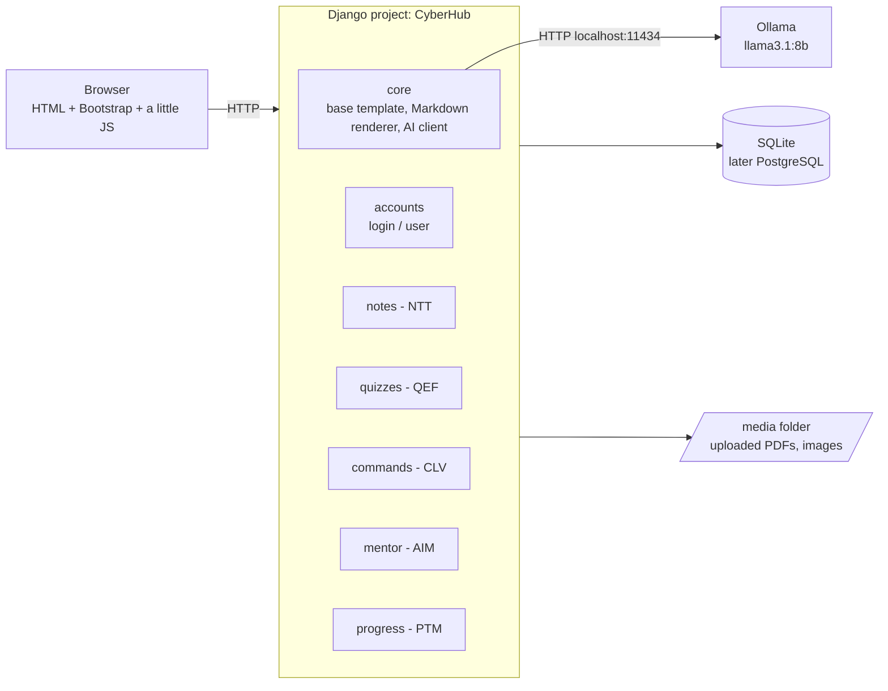
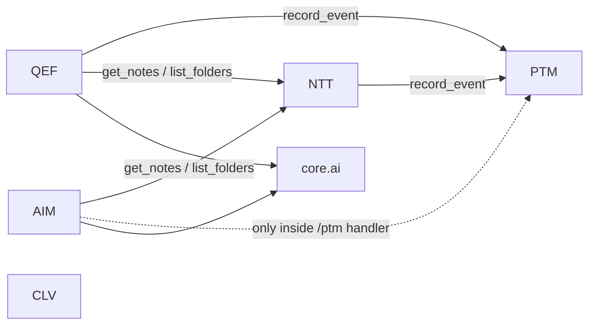
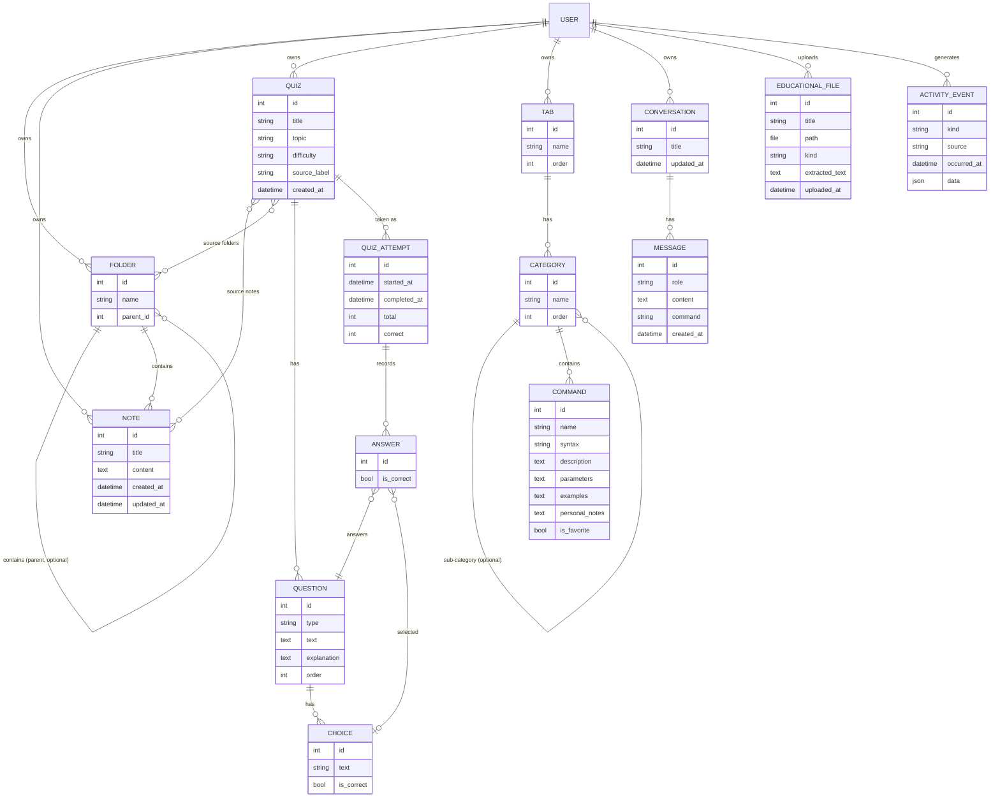

# CyberHub — Architecture

> **Status:** Draft proposal — not yet approved. Decisions marked "recommended" become final only after the owner approves them (see §13 Open questions).
> **Date:** 2026-11-20

## Contents
1. Architecture overview
2. Recommended architectural approach
3. Technology stack evaluation
4. Project structure
5. Database design
6. Component integration
7. AI architecture (AIM + shared AI client)
8. NTT architecture
9. Security architecture
10. Testing strategy
11. Development roadmap
12. Architectural decisions
13. Open questions

### Development environment (checked 2026-11-20)
| Item | Value | Impact |
|---|---|---|
| Python | 3.12.4 | Supported by Django 5.2 |
| Django | 5.2.4 installed globally | Project will use a `venv/` instead |
| Ollama | 0.40.16 — `llama3.1:8b`, `nomic-embed-text` | Embedding model available for future RAG |
| GPU | GTX 1070 Ti, 8 GB VRAM | Model (~4.9 GB) fits on GPU; ~8K–16K token context is realistic |
| RAM | 8 GB | Tight — keep the stack light |

---

## 1. Architecture overview

CyberHub is **one Django website** made of **five feature modules** plus a small shared core. Everything runs locally: the browser talks to Django, Django stores data in SQLite, and Django talks to Ollama over `localhost` when AI is needed.



---

## 2. Recommended architectural approach — modular monolith

**What it is:** a single application split internally into clearly separated modules that talk only through small public "front doors".

**Why:**
- **Microservices** (5 programs + APIs between them) add deployments, network calls and inter-service auth — no benefit for one user on one machine.
- **A "big ball of mud"** (everything imports everything) is easy at first and painful later.
- A modular monolith is **as simple to run as one app** and **as organized as separate services**; clean boundaries allow splitting later if ever needed.

### Django organization
- **One Django app per component:** `notes` (NTT), `quizzes` (QEF), `commands` (CLV), `mentor` (AIM), `progress` (PTM).
- **`core`** — shared, feature-free building blocks: base template, Markdown renderer + sanitizer, Ollama client. `core` never imports component apps.
- **`accounts`** — custom user model and login pages.

### Communication — service functions
Each app exposes **`services.py`** as its public API. Other apps call only these functions:

```python
# quizzes calls notes like this — never imports notes.models
from notes import services as notes_services
notes = notes_services.get_notes(user, folder_ids=[3])
```

| Option | Verdict |
|---|---|
| **Service functions** ✅ | Explicit, readable, testable — recommended |
| Importing other apps' models | Tight coupling; renaming a field breaks other apps |
| Internal REST API | Network overhead inside one program |
| Django signals | Hidden control flow; possibly useful later |

**Loose-coupling rules**
1. **Read services return plain data, not model objects** (e.g. a `NoteData` dataclass). Callers cannot accidentally `save()` — "read-only" is enforced by code.
2. **Dependencies point one way:** PTM depends on nothing; NTT and QEF call PTM; QEF and AIM call NTT; AIM calls PTM only inside `/ptm`. Nothing calls AIM. No circular imports.



---

## 3. Technology stack evaluation

| Technology | Verdict | Reasoning |
|---|---|---|
| Python | ✅ Keep | Right language for Django and AI; part of the course |
| Django | ✅ **5.2 LTS** | Batteries included (auth, admin, forms, CSRF, ORM). LTS security support until April 2028 covers the whole course. Django 6.x adds features (built-in tasks, CSP) but is less stable as a learning base |
| HTML/CSS/Bootstrap 5 | ✅ Keep | Server-rendered pages are simplest to learn. Ship Bootstrap as **local static files** (offline, no third-party requests, CSP-friendly) |
| Vanilla JavaScript (minimal) | ✅ Necessary | Only for the Preview tab and chat box. No React/Vue |
| SQLite | ✅ Initially | Zero setup, ideal for one user |
| PostgreSQL | ⏳ Later | When deploying, using Docker, or needing `pgvector`. ORM-only code makes switching mostly a settings change |
| Ollama + llama3.1:8b | ✅ Keep | Installed, fits GPU. Expect responses in seconds to tens of seconds |
| LangChain | ❌ Not now | Our pipeline is ~100–150 lines of plain Python. Useful later for complex chains/agents or as a learning exercise |
| Docker | ⏳ Later | With PostgreSQL/deployment. Needs WSL2 on Windows 10 Home. Ollama stays on the host for GPU access |
| Git + GitHub | ✅ Day 1 | Project is not yet a Git repository — first step |

### Packages needed later (each requires approval in its phase)
| Need | Recommended | Alternative | Phase |
|---|---|---|---|
| Read `.env` | `django-environ` (also parses `DATABASE_URL`) | `python-dotenv` | 0 |
| Markdown → HTML | `markdown-it-py` (closest to GitHub) | `Python-Markdown` | 1 |
| HTML sanitizing | `nh3` (`bleach` is deprecated) | — | 1 |
| Code highlighting | `Pygments` (server-side) | highlight.js | 1 |
| Ollama access | `ollama` (official library) | `requests` | 4 |
| PDF text | `pypdf` (pure Python, permissive licence) | PyMuPDF (AGPL) | 6 |

---

## 4. Project structure

```
CyberHub/
├── manage.py
├── requirements.txt          # pinned dependency versions
├── .env.example              # variable NAMES only (committed); real .env is gitignored
├── .gitignore                # venv/, .env, db.sqlite3, media/, logs/, __pycache__/
├── README.md                 # portfolio front page
├── docs/                     # setup guide, decision records (ADRs)
│
├── config/                   # Django project settings
│   ├── settings.py
│   ├── urls.py               # root URLs: includes each app's urls.py
│   └── wsgi.py / asgi.py
│
├── core/                     # shared, feature-free building blocks
│   ├── markdown.py           # render_markdown(text) → sanitized HTML (one renderer for all)
│   ├── ai/
│   │   └── client.py         # the only code that talks to Ollama
│   ├── templates/core/base.html
│   └── static/core/          # bootstrap/, app.css, preview.js
│
├── accounts/                 # custom User model, login/logout templates
│
├── notes/        (NTT)       # every component app has the same shape:
├── quizzes/      (QEF)       #   models.py   – data owned by this component
├── commands/     (CLV)       #   services.py – public functions for other apps
├── mentor/       (AIM)       #   views.py, urls.py, forms.py, admin.py
├── progress/     (PTM)       #   templates/<app>/, tests/
│   mentor/ also: commands.py (secret-command registry), prompts.py, documents.py (PDF text)
│
├── media/                    # uploads (gitignored, never served publicly)
│   ├── mentor/files/
│   └── notes/attachments/
├── logs/                     # log files (gitignored)
└── venv/                     # virtual environment (gitignored)
```

- **Templates, static files and tests live inside each app** — components are self-contained; only the shared layout is in `core`.
- **Markdown notes live in the database**, not in a folder (§8). `media/` is only for real uploads.
- **AI client is in `core`**, not `mentor`, because QEF uses it too.

---

## 5. Database design

### Basics
- **Table** = spreadsheet, one row per item. **Foreign key (FK)** = a column holding another row's ID (creates a relationship).
- **`on_delete`**: CASCADE (delete children), PROTECT (refuse), SET_NULL (blank the link).
- Every table has a `user` FK and every query filters by user — prevents accessing others' data by changing an ID in the URL.

### ER diagram



### NTT — notes and folders
- **Folder:** `name`, optional `parent` (Folder), `created_at`. `parent = NULL` → top-level.
- **Note:** `folder` (FK), `title`, `content` (raw Markdown), `created_at` (shown under the name), `updated_at`.
- Deleting a non-empty folder is **PROTECTed** — a misclick never wipes notes.

### QEF — quizzes, questions, attempts, answers
- **Quiz:** `topic`, `difficulty`, `source_label` (e.g. "Folder: Networking"), M2M links to source notes/folders (links disappear if a note is deleted; the quiz survives).
- **Question:** `type` (multiple choice / true-false), `text`, `explanation`. Stored **as generated** — a deliberate snapshot so old quizzes don't change when notes are edited.
- **Choice:** one row per option; true/false = 2 choices, so all types work the same.
- **QuizAttempt:** one row per attempt (retakes allowed). `completed_at` empty = in progress.
- **Answer:** chosen option per question + `is_correct` — enables reviewing incorrect answers.

### PTM — event log
- **ActivityEvent:** `kind` (`note_created`, `quiz_completed`, …), `source` (`ntt`, `qef`), `occurred_at`, `data` (small JSON, e.g. `{"quiz_id": 7, "topic": "Subnetting", "total": 10, "correct": 7}`).
- Statistics are **computed by queries** over events — no counters that can drift.
- **Not duplication:** QEF owns *the quiz*; PTM owns *the history of activity* (like a bank statement vs. a wallet). Computing stats live from other apps would make deleted notes vanish from history and make PTM depend on every component.

### CLV — command library
- **Tab** → **Category** (optional `parent` for sub-categories) → **Command**.
- **Command:** `name`, `syntax`, `description`, `parameters`, `examples`, `personal_notes` (Markdown text), `is_favorite`.
- Tabs and categories are data created in the UI — no code changes to add new ones.

### AIM — mentor
- **Conversation** → **Message** (`role`, `content`, `command` used, e.g. `exlit`).
- **EducationalFile:** uploaded file + `extracted_text` stored once at upload.
- Later, only if RAG is approved: **Chunk** (text + embedding) — a rebuildable index (§7).

---

## 6. Component integration

| Flow | How | Data copied? |
|---|---|---|
| NTT → QEF | `notes.services.get_notes(user, note_ids=…, folder_ids=…)` at generation time | No — only generated questions are stored |
| NTT → AIM | Same NTT read services, when notes/folders are attached | No |
| NTT → PTM | `progress.services.record_event(user, "note_created", source="ntt", data={...})` after save | Event only |
| QEF → PTM | `record_event(user, "quiz_completed", source="qef", data={total, correct, incorrect, topic, quiz_id})` | Event only |
| PTM → AIM | Inside `/ptm` handler only: `progress.services.get_summary(user)`, `get_weak_topics(user)` | No |

**Entry into PTM:** direct `record_event()` calls (recommended — visible, easy to trace and test) vs. Django signals (looser coupling, hidden flow). Because everything goes through one function, switching later only touches callers.

---

## 7. AI architecture

### Django ↔ Ollama
Ollama is a local HTTP server (`http://127.0.0.1:11434`). All access goes through **`core/ai/client.py`** with ~3 functions: `chat(messages, …)`, `generate_json(messages, schema)`, later `embed(text)`.
- Model, host, timeout and context size configured in one place (settings / `.env`).
- Tests replace this module with a fake — the test suite never calls the real model.
- Ollama offline → one clear "AI is offline — start Ollama" message.

### Chat request flow

```mermaid
sequenceDiagram
    participant U as User (browser)
    participant V as mentor view
    participant R as command registry
    participant N as notes.services
    participant P as progress.services
    participant AI as core.ai.client → Ollama
    U->>V: "/ptm what should I revise?" (+ selected folder)
    V->>R: parse first word of the user's own text
    R->>P: get_summary(user), get_weak_topics(user)   (ONLY /ptm)
    V->>N: get_notes(user, folder_ids=[…])  (if sources selected)
    V->>AI: system rules + delimited context + last N messages + question
    AI-->>V: answer
    V->>V: save Message rows; render via sanitized Markdown
    V-->>U: answer
```

### Secret commands (`/exlit`, `/ptm`, future)
- **Registry:** `{"exlit": ExlitCommand, "ptm": PtmCommand}` — each handler adjusts the prompt and/or adds context.
- Recognized **only at the start of the user's own typed message** — never in notes, PDFs or AI output.
- New command = one handler + one registry line; the chat view never changes.
- Unknown `/xyz` → friendly "unknown command" (no AI call).
- "Secret" = hidden from UI, **not** a security mechanism.

### Conversation history
Stored in DB; send the **last N messages** fitting a size budget. Summarizing older history is a later option.

### Context size
- Ollama's default context window is far below llama3.1's 128K maximum; larger context costs GPU memory.
- On 8 GB VRAM: model ~4.9 GB + ~0.13 GB per 1K tokens → **8K–16K tokens** is realistic (≈ 20–25 pages at 8K). `num_ctx` set explicitly in one setting.

### Retrieval stages
| Stage | Method | When |
|---|---|---|
| 1. Put selected text in the prompt ✅ | Selected notes/folders/files inserted, within a budget; clear message if too much is selected | Phase 6 |
| 2. Simple RAG | Chunk → embed with `nomic-embed-text` → vectors in a DB table → top ~5 chunks by similarity | When material regularly exceeds the budget |
| 3. Vector database | `pgvector` or `sqlite-vec` | Only if stage 2 becomes slow |

- **Embedding ownership:** AIM owns them as a **rebuildable index** (note IDs + `updated_at`); stale notes are re-embedded. NTT needs no knowledge of AIM.
- **LangChain:** not needed for stages 1–2; worth it for complex chains, many loaders, or tool-using agents.

### Educational documents
- Upload: verify signature (`%PDF-`), size limit, random filename, stored in `media/`.
- Extract text once with `pypdf` into `extracted_text`; scanned PDFs (no text layer) are marked "no text found" — OCR out of scope.
- Transcripts: plain text formats read directly (format to be confirmed).

### QEF generation
- Use Ollama **structured outputs** (JSON schema via `format`).
- **Validate** before saving (choice count, exactly one correct, no empty text); retry once, then show an error.
- User can **edit/delete questions** before taking a quiz (8B models make mistakes).
- Generation may take 30–90 s: start synchronous with a spinner; background tasks only if needed.

### Prompt-injection defence
- Retrieved content goes in clearly delimited "data, not instructions" blocks, separate from system instructions.
- The model never triggers actions — only user-typed commands do.
- AI output is rendered through the same sanitizer as notes.

---

## 8. NTT architecture

### Storage: database vs files
| | Database (TextField) ✅ | `.md` files on disk |
|---|---|---|
| Created date, folder, user | Simple columns | Inferred from filesystem (unreliable) |
| Search, QEF/AIM access | One ORM query | Walk directories, parse files |
| Security | No user-built file paths | Path-traversal risk |
| Backup | One DB file | Folder tree kept in sync |
| External editors, git diff | ❌ | ✅ |

**Recommendation:** database is the single source of truth + later **"Export as .md / .zip"**.

### Folders
`Folder` with optional `parent`. Flat usage is possible now; nesting needs no schema change.

### Code / Preview editor
- Opening a note → server-rendered, sanitized HTML (Preview by default).
- **Edit** → two Bootstrap tabs: **Code** (`<textarea>` with raw Markdown) and **Preview** (POST text + CSRF to `/notes/preview/`, returns HTML from the same `core.markdown.render_markdown()`).
- **Why server-side preview:** one renderer = Preview always matches the saved view; sanitizing in one trusted place; no JS Markdown library or DOMPurify needed.

### Rendering pipeline
`raw Markdown → markdown-it-py → Pygments highlighting → nh3 allowlist sanitizer → mark safe → template`
Shared by NTT, CLV examples and AIM answers.

### Images and attachments
| Option | Pros | Cons |
|---|---|---|
| External links only | Nothing to build | Broken links; remote loads leak IP |
| Uploads ✅ (later phase) | Class screenshots stay with notes | Validation, storage, ownership-checked view |

Phase 1: Markdown image syntax only; `NoteAttachment` uploads in a later phase.

### Access by AIM and QEF
Only via `notes/services.py`: `list_folders(user)`, `get_notes(user, folder_ids, note_ids, include_subfolders)` → `NoteData` with raw Markdown.

---

## 9. Security architecture

| Area | Practice |
|---|---|
| Authentication | Django built-in login; **no public sign-up** — account via `createsuperuser` |
| Authorization | `@login_required` everywhere; `get_object_or_404(Model, pk=…, user=request.user)`; tests prove other users get 404 |
| CSRF | Token on every form and JS POST; never `@csrf_exempt` |
| Markdown / XSS | `nh3` allowlist; strip `<script>`, `<iframe>`, `on*=`, `javascript:`; never `|safe` unsanitized content, including AI output |
| File uploads | Extension + signature + size checks; random names; `media/` never public — served by an ownership-checking view |
| PDF processing | Maintained `pypdf` kept updated; size/page limits; errors caught; never executed |
| Local AI | Ollama bound to `127.0.0.1`; delimited untrusted context; model cannot trigger actions; structured output validated |
| Database | ORM only (no SQL string building); DB file gitignored |
| Secrets | `.env` (gitignored) + `.env.example` with names only; `DEBUG=False` + `ALLOWED_HOSTS` outside local dev; `check --deploy` before deployment |
| Backup & recovery | Scheduled copy of `db.sqlite3` + `media/` (or `dumpdata`) to another drive/cloud; code on GitHub; **test a restore once**; `.md` export as extra safety |
| Logging | No full prompts or school data at INFO level |
| Headers | `SecurityMiddleware` now; Content-Security-Policy as later hardening (easy with local Bootstrap) |

---

## 10. Testing strategy

| Kind | Meaning | Example |
|---|---|---|
| Unit | One function in isolation | `render_markdown("<script>…")` outputs no `<script>`; parser detects `/exlit` only at start |
| Component | One app's views, forms, services | Create note → saved with today's date; other user gets 404 |
| Integration | Two components via services | Completing a quiz → exactly one `quiz_completed` event with correct counts |
| AI | Always with a fake AI client | Malformed JSON → error shown, nothing saved |

- **Tool:** Django `TestCase` (`python manage.py test`); `pytest`/`coverage` optional later.
- **Migrations:** small, named, committed with the code; never edit applied migrations; `makemigrations --check` catches forgotten ones.
- **Error handling:** expected failures (AI offline, bad PDF, invalid JSON) → friendly messages; unexpected → custom 500 page + log entry.
- **Logging:** Django `LOGGING`, one logger per module, console + `logs/cyberhub.log`.
- **Code quality:** PEP 8, type hints on services, small functions; optional `ruff` and GitHub Actions CI later.
- **Maintenance:** short decision records in `docs/decisions/`; regular Django LTS patch upgrades.

---

## 11. Development roadmap

| Phase | Build | Components | Learn | Done when |
|---|---|---|---|---|
| **0. Foundation** | Git repo + GitHub, venv, Django project (`config`), `.env` settings, custom User, base template + Bootstrap, login/logout, test setup | core, accounts | Project structure, settings, auth, Git | Login works; tests pass; first push |
| **1. NTT** ⭐ | Folders, note CRUD, Markdown render + sanitize, Preview default, Code/Preview tabs, creation dates | NTT | Models, migrations, forms, CRUD, templates, XSS defence, a little JS | Used in class for real |
| **2. PTM basics** | Event log, `record_event`, NTT reports `note_created`, backfill existing notes, count dashboard | PTM, NTT | Service layer, cross-app integration, aggregation | Note count correct on dashboard |
| **3. CLV** | Tabs, categories, commands, search, favourites | CLV | Self-referencing relations, search, filtering | Used during labs |
| **4. AI foundation + AIM chat** | `core.ai.client`, chat with history, command registry, `/exlit` | core, AIM | HTTP to Ollama, prompts, timeouts, mocking | Chat works; Ollama-off handled |
| **5. QEF** | Generate from notes/folders/topic, structured JSON, validation, take quiz, review mistakes, results → PTM | QEF, NTT, PTM | Structured LLM output, complex relations, multi-step forms | Results appear in PTM |
| **6. AIM knowledge** | Attach notes/folders, upload PDFs/transcripts, extraction, `/ptm` | AIM, NTT, PTM | Uploads, PDF parsing, context budgeting, prompt-injection defence | AIM answers from notes; `/ptm` works |
| **7. PTM insights** | Per-topic accuracy, weak topics, progress over time, charts | PTM | Analytical queries, visualization | — |
| **8. RAG (if needed)** | Chunking, embeddings, similarity search | AIM | Embeddings, vector search | Large folders answered well |
| **9. Production-ready** | PostgreSQL, Docker, CI, backups, hardening, note images, export | all | DevOps, containers, CI/CD | `check --deploy` clean |

**MVP = Phases 0 + 1:** a secure, login-protected Markdown notebook. NTT comes first because it needs no AI, teaches core Django, and builds up the notes that QEF and AIM will later need.

---

## 12. Architectural decisions

| # | Decision | Recommendation | Status |
|---|---|---|---|
| D1 | Overall style | Modular monolith; one app per component + `core` | Proposed |
| D2 | User model | Custom User model from day one | Proposed |
| D3 | Communication | `services.py` functions returning plain data; no cross-app model imports | Proposed |
| D4 | Note storage | Database as source of truth; `.md` export later | Proposed |
| D5 | Markdown | One server-side renderer + sanitizer shared by NTT, CLV, AIM | Proposed |
| D6 | PTM design | Event log; statistics computed by queries | Proposed |
| D7 | AI access | One `core.ai.client` module; mocked in tests | Proposed |
| D8 | Retrieval | Put selected text in prompt first; RAG only when needed; no LangChain/vector DB now | Proposed |
| D9 | Django version | 5.2 LTS | Proposed |
| D10 | Frontend | Server-rendered templates + local Bootstrap + minimal vanilla JS | Proposed |

---

## 13. Open questions

1. **NTT folders:** nested (Subject → Module → Lesson) or flat? *Leaning nested.*
2. **Note images:** external links now and uploads later, or uploads needed early?
3. **CLV depth:** fixed `Tab → Category → Command`, or nested sub-categories?
4. **Where CyberHub runs:** localhost only, or reachable from school/phone later? (affects HTTPS, deployment, Docker timing)
5. **Users:** single user forever, or possibly classmates later?
6. **PTM entry:** direct `record_event()` calls (recommended) or Django signals?
7. **Approve D2, D4, D9:** custom User model, notes in DB, Django 5.2 LTS?
8. **School transcript format:** PDF, .txt, .docx, subtitles? (.docx needs an extra library)
9. **Quiz topics for "weak topics":** source folder name, or typed per quiz?
